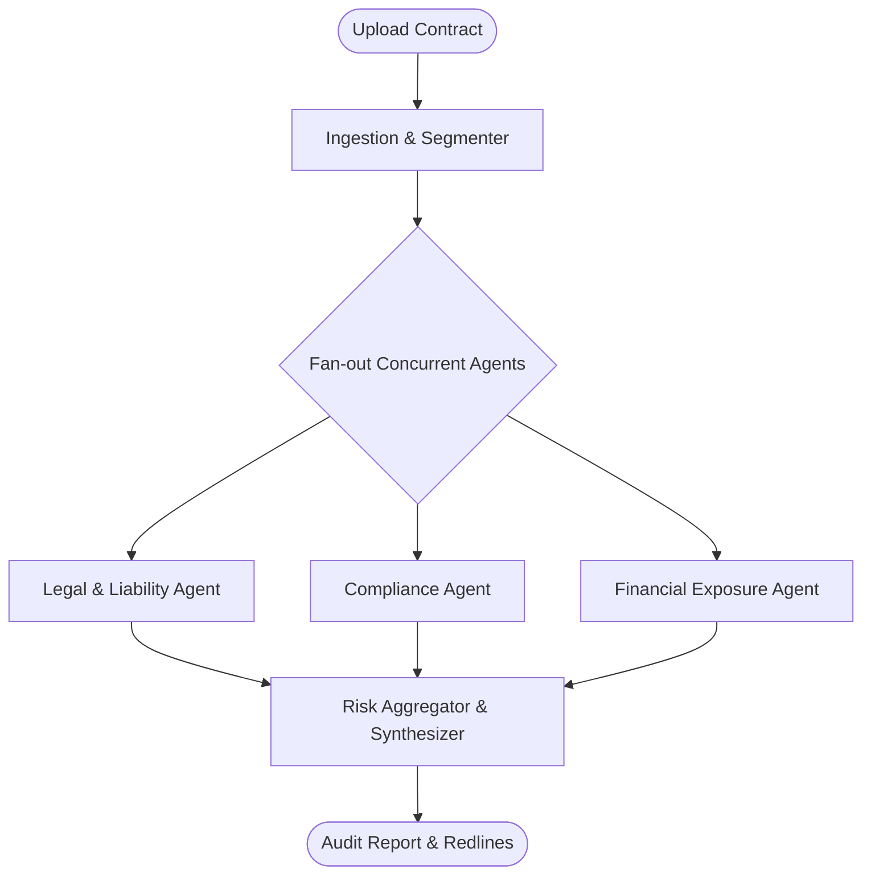

# ContractGuard — Multi-Agent System Blueprint

This document specifies the planned multi-agent architecture to be orchestrated with **LangGraph** in subsequent prompts.

## Agent Taxonomy

Contract analysis is partitioned into specialized roles to prevent context pollution and hallucination:

1. **Ingestion & Segmentation Agent**:
   - Parses unstructured contract documents (PDF via `PyMuPDF`, DOCX via `python-docx`).
   - Identifies structural sections (Preamble, Definitions, Term & Termination, Liabilities, Indemnities, Confidentiality, IP Assignment).
   - Segments clauses and embeds them into Qdrant vector space.

2. **Legal & Liability Specialist Agent**:
   - Audits uncapped liability, indemnification scope, warranty disclaimers, and force majeure clauses.
   - Compares language against standard market baselines.

3. **Regulatory & Compliance Specialist Agent**:
   - Audits GDPR/CCPA data transfer protections, audit rights, and jurisdictional governing law conflicts.

4. **Financial & Commercial Exposure Agent**:
   - Audits fee structures, price escalator terms, late payment penalties, and termination compensation.

5. **Risk Aggregator & Recommendation Synthesizer**:
   - Aggregates findings from specialized agents.
   - Normalizes risk scores on a calibrated 0–100 scale.
   - Formulates redlined negotiation counter-proposals.

## State Graph Schema (LangGraph Target)

