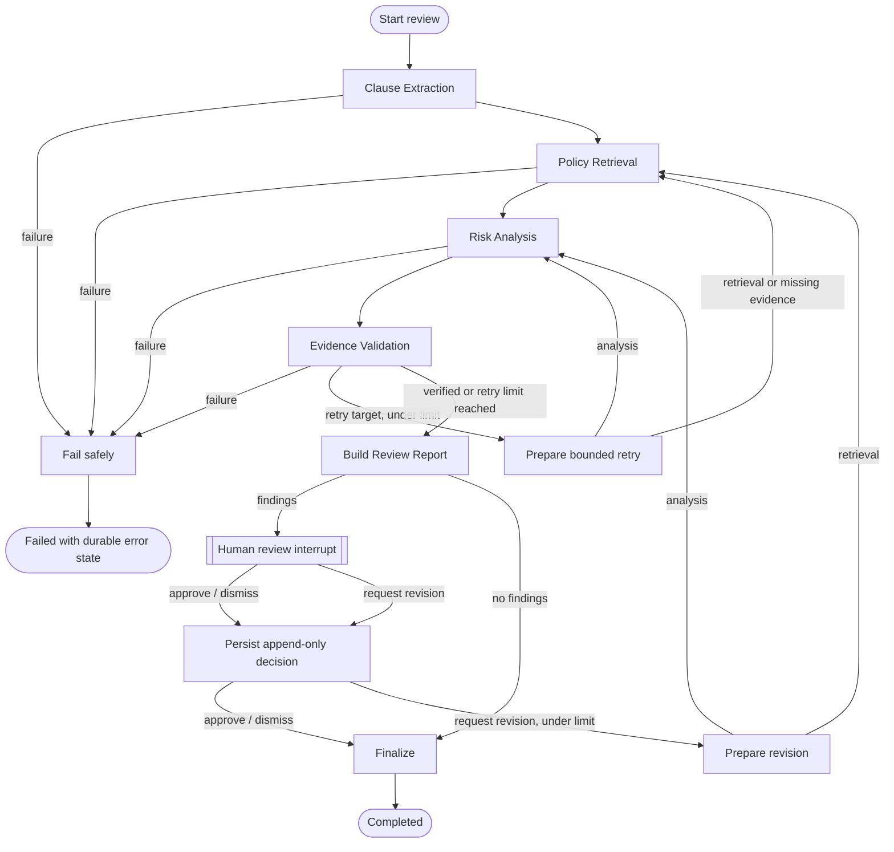

# LangGraph Workflow Orchestration & Human Review

The review workflow integrates the existing Clause Extraction, Policy Retrieval, Risk
Analysis, and Evidence Validation services behind a durable LangGraph state machine.
Graph nodes call the domain services; they do not reimplement extraction, retrieval,
risk rules, or evidence checks.

## Normal, retry, failure, and human-review paths



The graph enforces `WORKFLOW_MAX_RETRIES` automatic correction retries,
`WORKFLOW_MAX_STEPS` node steps, and `WORKFLOW_MAX_REVISIONS` human revision cycles.
The LangGraph invocation also uses the configured step limit as its recursion limit.
Exhausted validation gaps are surfaced to a human; they are never silently approved.

## Shared state

`WorkflowState` is a typed `TypedDict` containing IDs, compact clause/evidence/finding
summaries, validation outcomes, errors, review state, and run metadata. Full contract
text and full policy passages remain in PostgreSQL/Qdrant and are referenced by ID.
Each node writes run IDs and compact summaries; a state transition never copies an
entire source document.

## Checkpoint persistence

`CheckpointManager` owns the checkpointer lifecycle during FastAPI startup/shutdown:

- PostgreSQL: `langgraph-checkpoint-postgres` with `AsyncPostgresSaver`; the PostgreSQL
  connection string is derived from the effective application database URL (removing the
  SQLAlchemy `+asyncpg` driver suffix), and `setup()` initializes checkpoint tables.
- Local/tests: `langgraph-checkpoint-sqlite` with `AsyncSqliteSaver` at
  `WORKFLOW_CHECKPOINT_SQLITE_PATH`; `setup()` initializes checkpoint tables.
- Optional explicit override: `WORKFLOW_CHECKPOINT_DATABASE_URL`.
- Development fallback: in-memory checkpointer only if a persistent backend cannot be
  initialized and `APP_ENV` is not production.

Set `WORKFLOW_CHECKPOINT_BACKEND=auto|postgres|sqlite|memory`. Production should use
PostgreSQL. In-memory checkpoints do not survive a process restart.

## API

All workflow endpoints require:

- `X-Reviewer-ID`: stable reviewer identity.
- `X-Workflow-Key`: shared workflow API key (`WORKFLOW_REVIEW_API_KEY`).

Workflow ownership is enforced: only the reviewer who started a workflow can inspect,
retrieve results, or resume it. Start/status/results/resume are owner-authorized.

| Endpoint | Method | Purpose |
|---|---|---|
| `/api/v1/workflows` | POST | Start a workflow for an ingested document |
| `/api/v1/workflows/{workflow_id}` | GET | Inspect status, interrupt, events, and decisions |
| `/api/v1/workflows/{workflow_id}/results` | GET | Retrieve the report and persisted findings |
| `/api/v1/workflows/{workflow_id}/resume` | POST | Approve, dismiss, or request revision |

Use `Idempotency-Key` on start and resume. Start with the same key returns the same
workflow. Resume with the same key returns the existing decision/state without appending
a duplicate reviewer decision. A resume body can also carry `command_id`.

### Start

```http
POST /api/v1/workflows
X-Reviewer-ID: reviewer-123
X-Workflow-Key: <key>
Idempotency-Key: start-2026-11-07-001
Content-Type: application/json

{
  "document_id": "document-uuid",
  "enable_model_analysis": false,
  "max_retries": 2,
  "max_steps": 30
}
```

When findings exist, the response is `201 Created` with `status: "awaiting_review"` and
a `review_request` interrupt payload. The process is paused durably; no legal or
contractual action has occurred.

### Resume

```http
POST /api/v1/workflows/{workflow_id}/resume
X-Reviewer-ID: reviewer-123
X-Workflow-Key: <key>
Idempotency-Key: decision-001
Content-Type: application/json

{
  "decision": "approve",
  "finding_ids": ["optional-finding-id"],
  "notes": "Reviewed the liability deviation."
}
```

Decision values:

- `approve`: marks selected findings reviewed (human review, not automatic verification).
- `dismiss`: marks selected findings dismissed.
- `request_revision`: requires `revision_instructions` or `notes`; reruns analysis or
  retrieval according to `revision_target`, then pauses for review again.

Reviewer decisions are append-only rows in `review_decisions`. Earlier decisions are
never updated or deleted. Workflow events record start, node transitions, interrupts,
resumes, decisions, completion, and failure.

## Separation of automatic verification and human review

`validation_status` comes from the independent Evidence Validation Agent. The human
review state is stored separately in `review_status` and append-only `review_decisions`.
Approving a finding does not change its evidence-validation result. Neither automatic
validation nor human approval executes or authorizes legal/contractual action; the
review report is decision support only.
